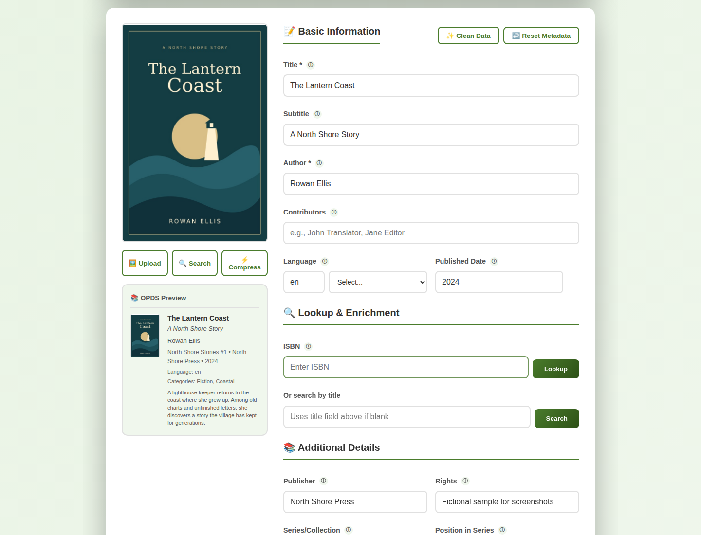
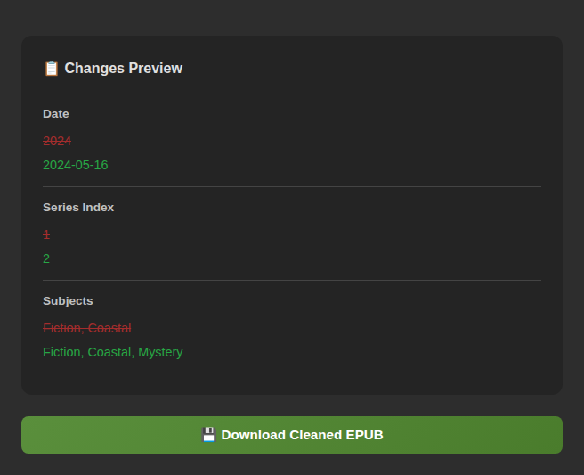
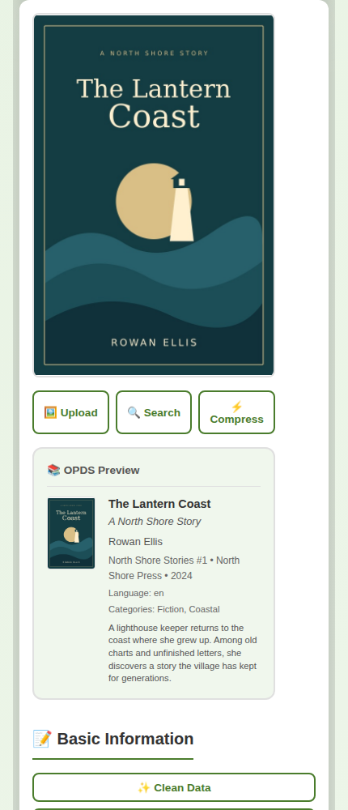
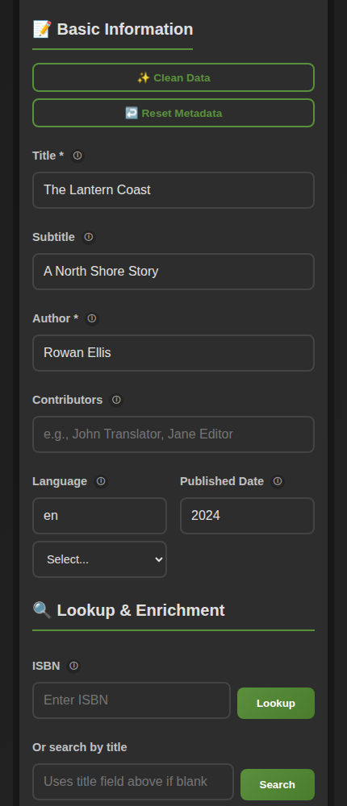

# EPUB BookPrep

A self-hosted web app for editing EPUB metadata and covers before adding a book to your library. Upload an EPUB, adjust its details, review the changes, and download the updated file. No account or database is needed.



## What it does

- Edit titles, authors, contributors, language, publication date, publisher, series, identifiers, summaries, and categories.
- Look up metadata by ISBN or title, then apply all fields or choose individual fields.
- Upload a cover or search for alternatives. Compress covers by resizing and converting them to JPEG.
- Clean whitespace, normalize dates and language codes, strip HTML from summaries, and remove duplicate categories.
- Preview a book's details as an OPDS entry and review field changes before downloading.
- Work with EPUB 2 and EPUB 3 files, on desktop or mobile, in light or dark mode.

The focus is metadata and covers. For editing chapters, layout, or book structure, use an authoring tool such as Sigil or Calibre.

## Screenshots

The screenshots use a fictional sample book, *The Lantern Coast*.

**Review changes before downloading**

The change preview shows the original and edited values. Here, the publication date, series position, and categories have been updated in dark mode.



**On mobile**

The cover and OPDS preview appear above the metadata fields on smaller screens.

<p>
  
  
</p>

## Using it

1. Drop an `.epub` file into the upload area, or click to browse.
2. Edit its metadata. Optionally look up missing details, replace the cover, or use **Clean Data**.
3. Check the OPDS and change previews.
4. Select **Download Cleaned EPUB**, then import the result into your library or reader.

A [temporary public demo](https://gjessing.io/epub/demo/) is available for light, manual testing. Availability is not guaranteed.

## Run with Docker

Save the example [`docker-compose.yml`](examples/docker-compose.yml), then run this command from the same directory:

```bash
docker compose up -d
```

Open [http://localhost:3007](http://localhost:3007). No volumes or environment variables are required. You can also put the app behind a reverse proxy such as Caddy, Traefik, or Nginx.

## Run from source

With Node.js and npm installed:

```bash
npm ci
npm start
```

The server listens on port `3007` by default. Set `PORT` to use a different port.

## File handling

EPUB files are uploaded to the server and processed in memory. The server keeps each upload and its metadata in a temporary session for up to 30 minutes, with expired sessions removed by a cleanup task that runs every minute. Downloading a file leaves the session available for further edits until it expires. Restarting the server clears all sessions.

Uploads are limited to 50 MB. The app does not write uploaded books to disk or require persistent storage. Metadata and cover lookups contact external services when requested.

## Contributing

Bug reports and suggestions are welcome through the repository's issues. For a bug report, include the steps to reproduce it and any error message.

Inspired by [BentoPDF](https://github.com/mgmeyers/bentopdf) in philosophy and workflow. Licensed under the [MIT License](LICENSE).
